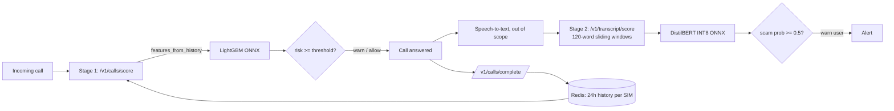

# CallShield — Two-Stage Incoming Call Fraud Detection

CallShield flags fraudulent phone calls at two moments:

1. **Before the call is answered (Stage 1)** — a LightGBM model scores the call from the caller SIM's recent network behaviour (call volume, callee diversity, timing, mobility, SMS/data use), targeting **SIM-box bypass fraud**.
2. **While the call is in progress (Stage 2)** — a fine-tuned DistilBERT model scores the live transcript in sliding windows and warns as soon as the conversation looks like a scam.

Both models are exported to ONNX and served by a FastAPI service with a Redis-backed per-SIM feature store. Every number below is produced by the pipeline and stored in [`reports/`](reports/) — see [`reports/RESULTS.md`](reports/RESULTS.md) for the full tables.



## Results (Apple M4 Pro, macOS)

### Stage 1 — call metadata ([FraudZen](https://doi.org/10.57745/TAV6PQ), INRIA)

139,683 calls (26,932 fraudulent) from 30 simulated network-days. Test set = **unseen scenarios and unseen legitimate subscribers**; decision threshold chosen on validation only.

| Model | PR-AUC | ROC-AUC | F1 | Recall @ 1% FPR |
|---|---|---|---|---|
| Operator rule (SIM uses no data/SMS + call volume) | 0.747 | 0.812 | 0.782 | 0.672 |
| Logistic regression | 0.835 | 0.909 | 0.784 | 0.670 |
| **LightGBM** | **0.966** | **0.987** | **0.928** | **0.907** |
| LightGBM without hour-of-day (ablation) | 0.892 | 0.961 | 0.844 | 0.784 |

| Strategy (FraudZen) | Test fraud rate | LightGBM PR-AUC | Leave-strategy-out PR-AUC |
|---|---|---|---|
| naive | 5.2% | 0.745 | 0.731 |
| mobility (SIMs move between cells) | 5.2% | 0.765 | 0.734 |
| social (SIMs imitate real contact networks) | 30.4% | 0.997 | **0.424** |

### Stage 2 — call transcripts

| Model | Synthetic test F1 (both corpora) | Recall on 20 **real** scam-call transcripts |
|---|---|---|
| TF-IDF + logistic regression (trained on mix) | 1.000 | 0.45 |
| DistilBERT (trained on mix, first 256 tokens) | 1.000 | 0.55 |
| DistilBERT INT8, **sliding windows** (deployed) | 0.994–0.958 (FPR 1.3%–8.7%) | **0.75** |

| Deployment | Size | p50 / p95 latency |
|---|---|---|
| DistilBERT PyTorch FP32 | 268 MB | 12.0 / 13.1 ms per 120-word chunk |
| DistilBERT ONNX INT8 (dynamic quantisation) | **67 MB (4× smaller)** | 10.2 / 11.2 ms — no F1 change |
| API `/v1/calls/score` (HTTP end-to-end, 4 workers) | LightGBM ONNX 553 KB | **0.51 / 0.55 ms** |
| API `/v1/transcript/score` | | 25.1 / 27.8 ms |

## What I learned (the interesting part)

- **Leakage in the simulator split.** FraudZen reuses the same legitimate subscribers in every scenario, so splitting by scenario alone puts *identical* legitimate calls in train and test. Legitimate callers are therefore split by phone number (60/20/20) and fraud SIMs by scenario; inverse-sampling weights restore the true class balance in the metrics.
- **The aggregate PR-AUC hides weak spots.** 0.966 overall is driven by the high-volume *social* strategy. Naive and mobility fraud SIMs make only ~1 call each per day, so most of their calls arrive with no history — per-call detection is fundamentally limited there (PR-AUC ≈ 0.75).
- **Generalisation to unseen fraud behaviour is poor for "social" fraud** (PR-AUC 0.42 when that strategy is held out): fraudsters who imitate real contact networks are not caught by a model that never saw them.
- **Time of day matters a lot** (23% of gain). Bypass traffic follows the international calling pattern; whether that is realistic or a simulator artefact is an open question, so the ablation without it is reported too.
- **Synthetic transcript benchmarks are saturated.** Even TF-IDF reaches F1 = 1.00, and the two corpora are near-copies in style (median nearest-neighbour cosine 0.85), so they cannot rank models. On real scam-call transcripts recall drops to 0.40–0.75: the synthetic-to-real gap is the real result of Stage 2.
- **Scoring the whole call matters.** Real transcripts average ~480 words; a single 256-token pass sees only the opening. Sliding windows raise real-call recall from 0.50 to 0.75 but also raise false alarms on legitimate synthetic calls (1.3% → 8.7%) — a threshold/UX trade-off, not a free win.
- **INT8 quantisation** gave a 4× smaller model with zero F1 loss but only ~1.2× speed-up on Apple Silicon.

## Engineering

- **No train/serve skew:** one function, [`features_from_history`](src/callshield/cdr/features.py), computes features offline (replaying CDRs in time order) and online (from Redis). [`tests/test_api.py`](tests/test_api.py) replays real traffic through the API and asserts the online features equal the offline training features.
- **No look-ahead:** only events that *finished* before the scored call are used.
- **ONNX parity:** the exported LightGBM agrees with the original on 100% of decisions (99.9th-percentile probability difference 1.5e-7).
- **Experiment tracking:** MLflow (SQLite backend) — `mlflow ui --backend-store-uri sqlite:///mlflow.db`.
- **Plain PyTorch training loop** for DistilBERT (AdamW, linear warm-up/decay, gradient clipping, best-checkpoint by validation F1) on Apple MPS.

## Run it

```bash
bash scripts/setup_and_download.sh   # venv, packages, datasets (needs: brew install libomp)
bash scripts/run_all.sh              # full pipeline -> reports/RESULTS.md (~15 min on M4 Pro)

# serve
PYTHONPATH=src uvicorn callshield.serve.app:app --port 8000
curl -X POST localhost:8000/v1/calls/score -H 'content-type: application/json' \
     -d '{"caller": "+24400582599", "callee": "+24400517752"}'
docker compose up --build            # API + Redis
```

```
src/callshield/
  cdr/features.py     shared online/offline feature code
  cdr/data.py         FraudZen replay -> per-call table, leakage-safe split
  cdr/train.py        rule / logistic regression / LightGBM, ablation, leave-one-strategy-out
  text/data.py        transcript corpora, dedup, cross-corpus overlap removal
  text/baseline.py    TF-IDF + logistic regression
  text/finetune.py    DistilBERT fine-tuning (PyTorch)
  text/export_onnx.py ONNX export + INT8 dynamic quantisation + benchmark
  text/eval_windows.py sliding-window live-call evaluation
  serve/app.py        FastAPI + Redis feature store + ONNX Runtime
scripts/              setup, run_all, serving bundle, API benchmark, results summary
reports/              every measured number (JSON) + RESULTS.md
```

## Limitations

- Stage 1 data is **simulated**; FraudZen's `traffic` and `all_advanced` strategies produce almost no fraud calls in the operator CDRs (the SIM-box rejects them), so they cannot be detected per call and are excluded.
- The real-world transcript test set has only **20 scam calls and no legitimate calls**, so recall there is noisy and precision cannot be measured.
- Speech-to-text is out of scope; Stage 2 assumes a transcript stream.
- API throughput figures were measured with a single-process Python load generator and are client-bound; latency figures are the meaningful ones.

## Data & credits

- **FraudZen** — A. J. Kouam, A. C. Viana, A. Tchana, INRIA. *Simulating SIMBox Frauds for Detection Investigation* (CoNEXT-SW '22) and *Battle of Wits* (ASIA CCS '24). DOI [10.57745/TAV6PQ](https://doi.org/10.57745/TAV6PQ), CC BY 4.0.
- **Scam dialogues** — [`BothBosu/scam-dialogue`](https://huggingface.co/datasets/BothBosu/scam-dialogue), [`BothBosu/single-agent-scam-conversations`](https://huggingface.co/datasets/BothBosu/single-agent-scam-conversations), [`BothBosu/youtube-scam-conversations`](https://huggingface.co/datasets/BothBosu/youtube-scam-conversations) (Apache-2.0).
- **DistilBERT** — `distilbert-base-uncased` (Sanh et al., 2019).
